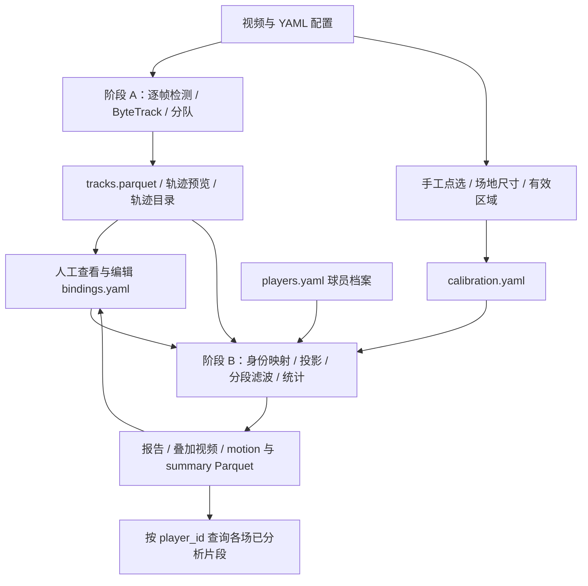
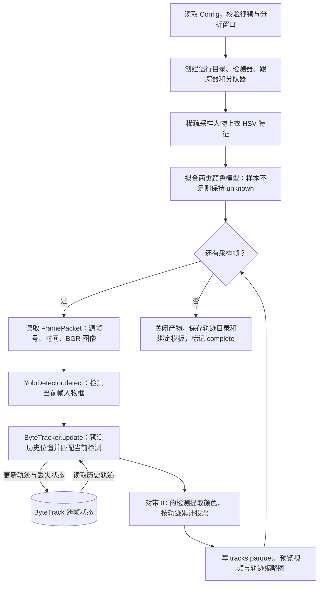
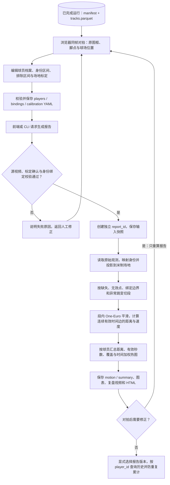
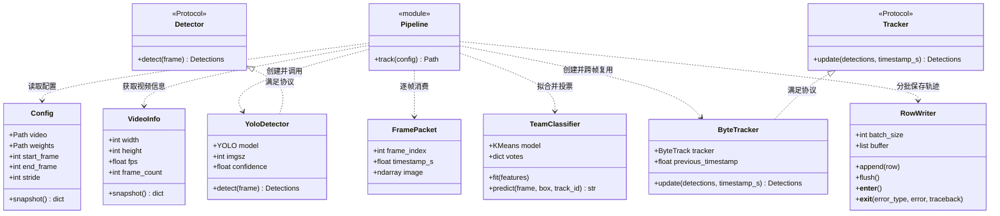
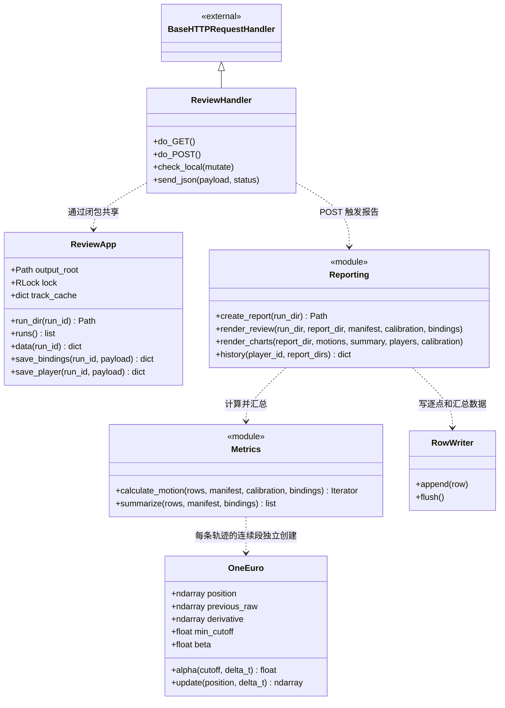

# 07 · 架构设计与最小闭环

> 日期：2026-10-15 ｜ 状态：**已确认，最小闭环原型已实现**；实片精度待验证，完成项见 [08 实现与验收记录](08-实现与验收记录.md)。用户补充：必须提供前端对照球员追踪与球场位置；每个可验收步骤提交并推送。
> 依据：[05 需求](05-需求确认单.md)、[06 范围](06-需求回执与范围确认.md)、[04 已定选型](04-主干选型清单.md)。沿用 D0–D13，以下是实现这些选择的最小方案。

## 一、闭环做到哪里

**输入一段固定机位视频，经一次场地标定和人工身份确认，输出可回看、可校正、可跨场查阅的球员跑动报告。**

| 必须交付 | 最小实现 |
|---|---|
| 球员检测、跟踪、分队 | YOLOv8n COCO + supervision ByteTrack + HSV/KMeans；队伍结果允许人工覆盖 |
| 场地坐标 | 手工对应点 + 单一单应性；默认 105×68 m，实际尺寸可配 |
| 球员身份 | 持久球员档案 + 按时间段绑定轨迹；出错后人工修正 |
| 统计 | 有效观测范围内的距离、平均速度、速度曲线、时间加权热图 |
| 复盘与归档 | 带身份/脚点/小地图的视频 + 静态 HTML 报告 + Parquet 数据；同一球员可查询多场结果 |

本轮不实现球、控球/传球、OCR、自动 ReID、多摄融合和准实时。增加本地浏览器调试台：逐帧原图叠框与球场小地图同步、点选标定、身份区间编辑、统计检查。距离为第一验收项，速度和热图复用同一轨迹，不增加独立识别链路。

## 二、架构：一个进程，两个计算阶段

### 总体数据流



- **阶段 A 负责较重的计算**：逐帧迭代，Parquet 分批写入，视频流式写出；只保留当前帧、跟踪状态和有限分队样本。首版单进程串行，先测完整吞吐，再决定是否加线程。
- **阶段 B 负责可反复修改的计算**：只读取缓存轨迹、标定和身份映射。修改身份、队伍、有效区域或滤波参数后，重新生成报告，无需重跑检测。渲染视频时重新顺序解码源视频。
- 两阶段以文件为边界，CLI 只做编排。浏览器调试台与 CLI 调用相同 Python 函数；检测器与跟踪器各留一个适配接口，不引入插件框架。

### 阶段 A：检测与跨帧跟踪流程

对应 `pipeline.track()`；每次运行只创建一个 `ByteTracker`，在采样帧循环中持续复用。



编号由 ByteTrack 的运动预测与检测框匹配延续；输出只包含匹配到检测的观测。跟踪状态仅存在于本次运行，遮挡、漏检或交叉仍可能导致换 ID，持久球员身份由后续人工绑定确认。

### 阶段 B：报告生成与人工纠错流程

CLI 与前端均调用 `reporting.create_report()`；修改绑定或标定后复用已有原始轨迹。



草稿标定可用于位置预览；生成报告要求标定已确认且至少绑定一名球员。无效观测保留原因，段首无位移与速度，修正重算保留原始轨迹和旧报告。

### 模块与接口

采用 `src/footballer_analyzer/` 布局，以下列出已实现模块及接口。

| 模块 | 职责 / 最小接口 |
|---|---|
| `cli.py`、`pipeline.py` | 参数校验与步骤编排：`track(config)`；报告交给 `reporting.create_report(run_dir)` |
| `video.py` | `read_frames(path, stride)` → `FramePacket`；读取真实帧率、分辨率、源帧号和时间戳 |
| `detection.py` | `YoloDetector.detect(frame)` → `supervision.Detections`；封装 YOLO `predict`，只接 person 类 |
| `tracking.py` | `ByteTracker.update(detections, timestamp_s)` → 带 ID 的 `supervision.Detections`；封装 supervision ByteTrack |
| `teams.py` | 有限样本拟合球衣颜色，按轨迹投票；输出 `team_id` 或 unknown |
| `calibration.py` | `save_calibration(run_dir, payload)`、验证几何与适用区间、投影脚点；前端点选与白线叠加 |
| `identity.py` | 档案读取、时间段绑定、排除裁判/场外人员、身份冲突校验 |
| `metrics.py` | 有效性判断、轨迹分段、滤波、距离/速度/热图统计 |
| `storage.py`、`reporting.py` | Parquet 分批读写、运行清单、轨迹目录、叠加视频和静态报告 |
| `server.py`、`web/` | 同帧原图与球场对拍、标定和身份编辑、本地 API、报告触发与统计展示 |

`FramePacket` 包含 `frame_index / timestamp_s / image`；检测与跟踪批次统一使用原视频像素坐标的 `bbox_xyxy / confidence / class_id`，跟踪批次另含 `track_id`。业务模块不依赖 Ultralytics 的结果对象。

依赖沿用现有 OpenCV、Ultralytics、supervision、numpy、scikit-learn，增加 PyYAML、pyarrow、matplotlib；CLI 使用 argparse。调试台使用原生 HTML/CSS/JavaScript，由 Python 标准库 HTTP 服务提供本地数据接口，默认只监听 127.0.0.1；不增加前端构建链。实现时记录实际验证过的依赖版本。

### 核心跟踪类图

类名和方法与源码对应；`Pipeline` 是 `pipeline.py` 模块，用 `module` 标注。`Protocol` 的实现关系表示结构化接口满足，不要求显式继承；第三方检测批次统一为 `supervision.Detections`。



`ByteTracker.tracker` 保存 supervision ByteTrack 内部状态；`TeamClassifier.votes` 保存当前运行内的颜色投票。两者均随新运行重新初始化。图中只列关键字段，`Config.end_frame` 和 `TeamClassifier.model` 可为空。

### 报告与本地复盘类图

`Reporting`、`Metrics` 分别表示 `reporting.py`、`metrics.py` 模块，其余为实际类。标定、档案和区间绑定使用字典及 YAML，通过模块函数处理，不另建业务类。



`handler_for(app)` 创建捕获同一 `ReviewApp` 的处理器类；请求通过共享锁串行执行编辑和报告生成。`OneEuro` 仅保存当前连续段的滤波状态，切段后重新初始化。

## 三、用户操作与产物

以下命令已实现；安装与前端操作顺序见项目根目录 README。

| 步骤 | 命令 / 人工动作 | 产物 |
|---|---|---|
| 1. 配置并跑跟踪 | `python -m footballer_analyzer track --config configs/demo.yaml` | `tracks.parquet`、`tracks.mp4`、`track_catalog.html`、`manifest.json`、`bindings.yaml` 模板 |
| 2. 标定 | `python -m footballer_analyzer calibrate --run <运行目录> --points configs/calibration_demo.yaml` 加载草稿；或前端点选对应点 | `calibration.yaml`；前端实时白线叠加，可导出对拍 PNG |
| 3. 绑定与排错 | `python -m footballer_analyzer serve`；浏览器逐帧检查并编辑身份区间，也可直接编辑 YAML | `bindings.yaml`、`data/players.yaml`；区间 → 球员映射、排除区间 |
| 4. 出报告 | `python -m footballer_analyzer report --run outputs/run_001` | `reports/report_001/` 中的 `motion.parquet`、`summary.parquet`、`review.mp4`、`report.html` 与配置快照 |
| 5. 修正 / 查历史 | 修改标定或绑定后再执行 report；`python -m footballer_analyzer history --player player_001 --reports <报告目录列表>` | 新报告版本；按比赛分组的已分析片段统计 |

一个运行目录对应一个视频分析窗口。检测重跑创建新 `run_id`；报告重算创建新 `report_id`，保留上版。身份绑定含 `run_id`，不得直接套用到另一次检测结果。

配置至少包含：视频路径、`match_id / clip_id / period / match_offset_s`、分析起止时间、模型路径、`imgsz=640 / conf=0.25 / stride=1`、球场尺寸、标定/档案路径和输出目录。`match_offset_s` 是片段首帧在该半场内的时间，未知可为空；文件名中的分钟数不直接当比赛时间。相对路径统一相对项目根目录解析，快照同时记录解析后的路径。

运行清单保存源视频 SHA256、原始视频信息、实际分析帧区间、配置快照、权重摘要、依赖版本、各阶段耗时和状态。报告清单额外保存标定/绑定/档案快照及其摘要。失败返回非零退出码并标记 failed，未完整关闭的 Parquet 不作为成功产物；首版失败后重跑该阶段，不实现逐帧续跑。

## 四、数据模型：像素轨迹、身份、统计分开存

帧号从 0 开始；所有区间为 **`[start_frame, end_frame)`**，使用源视频帧号。场地原点为选定参考方向的左上角，x 沿长度、y 沿宽度，单位米；方向与尺寸写入标定，片段内不变。

| 数据 | 核心字段 | 约束 |
|---|---|---|
| `data/players.yaml` | `player_id, display_name` | `player_id` 跨场稳定；号码、球队归属可随比赛变化，不作为主键 |
| `bindings.yaml` | `run_id`；各项的 `track_id, start_frame, end_frame, player_id, team_id, action` | `action=bind/exclude`；角色/球队由本场绑定确认；未绑定保持 unknown |
| `calibration.yaml` | 源视频摘要、参考帧、分辨率、图像点↔米制点、单应矩阵、场地尺寸、图像有效区域、有效帧区间、人工检查状态 | 首版每个运行只使用一个 H；图像有效区域限定可统计的地面范围 |
| `tracks.parquet` | `frame_index, timestamp_s, track_id, bbox_x1/y1/x2/y2, confidence, team_id` | 主键 `(frame_index, track_id)`；run 来自清单；只存匹配到检测的观测，不将 Kalman 外推帧伪装成观测 |
| `motion.parquet` | 原始轨迹键、`player_id, segment_id, x_m, y_m, x_smooth_m, y_smooth_m, valid, reason, delta_t_s, distance_delta_m, speed_mps` | 保留无效原因；缺值为 null；每段首点无位移/速度 |
| `summary.parquet` | `match_id, clip_id, player_id, team_id, distance_m, valid_seconds, coverage, avg_speed_mps` | 仅对有效时间边求和；未绑定轨迹不进入个人统计 |

YAML/JSON 用于少量配置和元数据，逐帧数据与统计表使用 Parquet，沿用 D7。`run_id` 与 `report_id` 由产物清单提供，跨报告读取时补入，避免局部轨迹键冲突。

**身份绑定示例**：

```yaml
run_id: run_001
bindings:
  - track_id: 7
    start_frame: 0
    end_frame: 75
    player_id: player_001
    team_id: home
    action: bind
  - track_id: 19
    start_frame: 90
    end_frame: 125
    player_id: player_001
    team_id: home
    action: bind
```

同一球员可以绑定多个轨迹片段；中间缺失 15 帧保持缺失，不补距离。若同一 `track_id` 在遮挡后实际换成另一人，按时间拆成不同绑定区间。一个轨迹区间只能有一个身份；同一球员在同一时刻绑定两个轨迹、同一球员本场队伍冲突、未知 player_id、越界区间均阻止报告生成。保留未绑定清单，允许只确认部分球员后出报告。

历史查询必须显式选择报告目录；同一 `clip_id` 只取一个版本。已知比赛偏移的同场同半场片段若时间重叠，拒绝累计；偏移未知时逐片展示，不自动累计同场总距离。跨场只累加已确认且不重复的片段，名称始终为“已分析片段累计”，不外推整场跑动。

## 五、算法约束：保证统计有明确含义

| 环节 | 首版规则 |
|---|---|
| 时间 | 默认 stride=1；恒定帧率素材用 `timestamp_s=frame_index/source_fps`。读取不到有效帧率则报错；可变帧率素材先转恒定帧率，首版不声称支持。抽帧后时间仍用源帧号，ByteTrack 缓冲按实际处理帧率换算 |
| 检测与分队 | COCO person 也包含裁判、教练；按有效区域筛选脚点并支持人工 exclude。有限稀疏采样收集上衣中央 HSV 特征后 KMeans(2)，再按轨迹投票；不直接剔除绿色像素，以免抹掉绿色球衣。颜色簇仅为候选，人工绑定时确认队伍，裁判/门将可能分错，颜色不明保持 unknown |
| 标定 | 至少 4 对非共线点，建议 6–12 点覆盖统计区域；用 `findHomography`，检查退化/有限值/白线叠加。点数足够时另留检查点；仅凭拟合点误差小不宣称精度达标。实际小场必须填真实尺寸，不套 105×68 |
| 适用范围 | 标定绑定分辨率、视频及有效区间；人工检查首/中/末帧白线叠加。运动体检提供辅助证据；切镜或明显漂移后结束窗口，重新分析/标定。未经检查或不匹配的标定不生成米制统计，已有跟踪结果仍可查看 |
| 投影 | 使用 bbox 底边中点；限定人工选定的可靠地面区域，排除裁切脚点、无穷投影和越出场地的点，不将越界坐标强行截到边线。明显鱼眼素材先去畸变或更换素材 |
| 身份与缺口 | 按绑定边界、漏检、无效点、异常跳变切段；同一 player_id 的不同段只累加各段结果，不连接跨段端点。首版不插值、不自动拼接轨迹 |
| 滤波与异常 | 每段独立使用 One-Euro，参数在配置中记录；从 `min_cutoff=1 Hz, beta=0` 起调，作为待验证初值。投影后先检出异常位移并切段，再平滑；成人素材速度上限暂用 12 m/s 触发复核，不将超限速度截成上限后计入 |
| 距离与速度 | 只连接同一段中相邻采样时刻的有效观测；漏掉一个采样时刻即断开。`distance_delta_m=norm(position_now-position_previous)`；`speed_mps=distance_delta_m/delta_t_s`；段首输出 null，平均速度为有效距离总和 / 有效时间总和 |
| 热图与覆盖 | 热图按上述有效时间边的 `delta_t_s` 加权落在米制网格中；`coverage=valid_seconds/分析窗口时长`。该比例表示有多少窗口时间进入统计，包含出画等影响，不作为检测召回率或真实出场时间 |

报告固定展示：分析窗口、已观测距离、有效秒数、覆盖比例、无效/未绑定数量、标定适用区域，以及速度曲线中的断点。无有效时间时统计显示“数据不足”，不显示成真实零距离/零速度。速度单位内部 m/s，展示可换为 km/h。

**限制需保留在结论中**：5 秒片段可以验证数据链路；球员框高只能粗看素材可用性，不能替代地面标定。文档中的“相机误差约 3.3%”是启发式估算，不是距离误差实测；±10% 仍需独立参考验证。

## 六、验收顺序与五天工作包

### 素材分工

| 素材 | 用途与边界 |
|---|---|
| `goodview_static_5s.mp4`：1080p25，125 帧 | 第一条工程闭环；有效性仍需标定检查，不承担整场或 ±10% 精度证明 |
| `goodview_15s.mp4`、`demo_15s.mp4`：1080p25，502 帧，实际 20.08 秒 | 检测/跟踪/分队验证；仅取通过检查的静止子窗口做米制统计 |
| `clip_*.mp4`：4 段，1080p30，约 65 秒 | 目标场景候选；先检查机位稳定性、真实场地尺寸和关键点，再选择一段用于较长验证 |
| `barca_girona_*.mp4`：6 段，1080p25，约 65 秒 | 补充遮挡、画面变化测试；不能默认固定机位，也不能把同场片段当六场比赛 |

### 可检查的完成标准

1. **工程闭环**：固定窗口跑通全部步骤，至少人工确认 3 名可见球员；轨迹表、个人统计、HTML、叠加视频均生成，源帧与小地图位置可逐点对照。
2. **人工纠错闭环**：演示一次“轨迹断开后重新绑定”和一次“同 ID 中途换人后按时间拆分”；只重跑 report，统计随映射更新，`tracks.parquet` 摘要不变。
3. **指标一致性**：summary 距离等于有效 `distance_delta_m` 之和，平均速度使用同一批有效时间；缺口/未绑定/排除区间不贡献距离，零有效观测显示数据不足。
4. **身份库闭环**：两个不同 `match_id` 的运行复用一个 player_id，历史查询展示两场记录；没有第二场已确认素材时，只演示数据结构，不把复制片段当跨场验证。
5. **精度验证单独记录**：取得固定机位下、可靠区域内一段独立已知路程的步行/跑动录像；用未参与拟合的距离/位置检查标定，并比较累计距离。记录相对误差、覆盖及失败情况；有参考后再判断是否达到 ±10%，否则标“精度待验证”。

| 工作包 | 交付物 | 验收点 |
|---|---|---|
| Day 1：骨架与跟踪 | Python 包、CLI、YAML、帧时间、YOLO/ByteTrack 适配、Parquet 与轨迹预览 | 原始轨迹可复跑；25/30 fps 不写死；分批处理 |
| Day 2：标定与分队 | 点选工具、可靠区域、H 与检查图、球队聚类 | 静止窗口脚点投影正确；队伍可人工覆盖 |
| Day 3：身份与距离 | 球员档案、区间绑定校验、分段/滤波、距离汇总 | 先通过工程与纠错闭环，再继续加表现层 |
| Day 4：复盘与归档 | 速度/热图、HTML、叠加视频、按球员跨场查询 | 数据和展示一致；累计不重复 |
| Day 5：验证与演示 | 候选长片检查、参数调整、参考距离验证（素材具备时）、复现说明 | 固定演示输入与配置；列明覆盖和精度证据 |

开发时为身份区间冲突、跨缺口不计距、帧率/stride 时间换算和汇总一致性建立少量单元测试；视频链路用上述素材人工对拍。单独记录分析与渲染耗时，不用检测单帧耗时外推系统准实时能力。

**实施顺序**：设计基线 → CLI 与视频跟踪 → 标定、身份与统计 → 前端对拍 → 集成验收与使用说明。每步完成验证后分别 commit 并推送，提交说明记录交付内容与验证结果。
