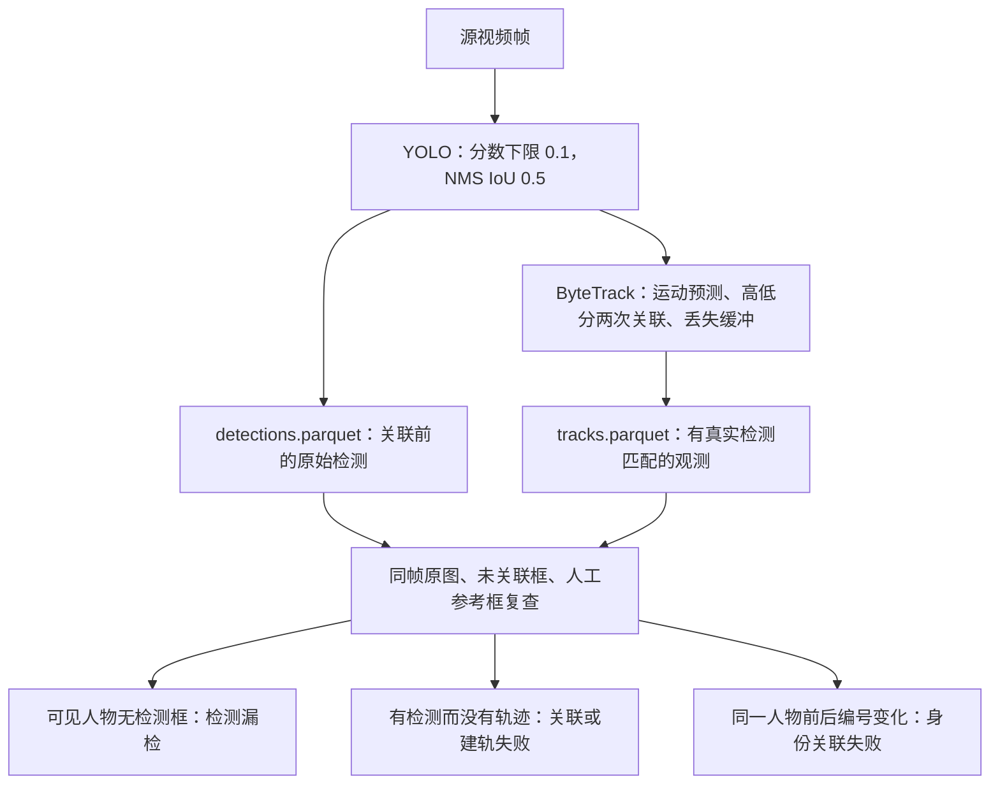

# 09 · 追踪丢失诊断与修复

> 日期：2026-10-15。针对本地 `bugs.md` 的 bug1 进行实片诊断和第一轮修复；bug2、bug3 的后续方案见末节。当前仍有遮挡后的编号变化，不能视为“身份稳定性已验收”。

## 一、结论与已修复原因

当前问题同时涉及检测和关联，单纯延长记忆或换模型不能解决全部断轨。

| 原因 | 代码与实测依据 | 本轮修复 |
|---|---|---|
| 小人物漏检 | 1080p 视频原先按 640 输入推理，五个抽样帧中的 105 人次只有 50 人次得到检测 | 默认演示改为 1280；另提供 1920 精度优先配置，继续使用本地 YOLOv8n |
| 低分关联被截断 | `detection.py` 原先 `confidence=0.25`；supervision ByteTrack 第二次关联需要 `0.1 < score < 0.25`，这些框已经在上游被删除 | 检测下限降为 0.1，与激活阈值 0.25 分开配置；新建轨迹仍需达到 0.35 |
| 重复框抢占同一人物 | 1280、默认 NMS IoU 0.7 时，门将在第 46–48 帧同时出现两条轨迹，后续框转而关联新编号 | 跟踪前将 NMS IoU 设为 0.5；门将连续 125 帧保持一个 ID |
| 丢失缓冲偏短且不可配置 | 原先 25 FPS 下缓冲约 25 帧，约一秒 | 增加 `lost_track_buffer_s=3`，依据实际 FPS/stride 换算；通过 40 帧缺失后恢复原号的回归测试 |

对同一批检测回放发现，640 下只延长缓冲从一秒到三秒，门将和近端白衣球员均没有改善。漏检未恢复、预测框无法匹配或重复框产生竞争时，保存更久的状态并不等于恢复身份。

本轮没有更换网络权重、引入自动 ReID，也没有向统计表补入预测位置。Kalman 状态可以继续预测；没有当前检测的帧仍不写球员观测，不累加缺口路程。

## 二、怎样区分问题发生在哪一环



- 前端勾选“未关联检测”：红色虚线代表有检测但没有轨迹，追踪框仍显示 ID，并增加置信度。下方显示检测、已关联和未关联数量。
- 原始检测包含场边人员、裁判和噪声，不能把检测数量当作在场球员数量。没有原始缓存的旧运行显示“未知”，需要重新执行 `track`。
- `scripts/review_tracking.py` 用人工参考框与检测、轨迹分别做一对一 IoU 匹配，输出 `diagnostics/review.json` 与抽样标框 JPG。一个合并框不能算成两名球员。

## 三、人工抽样与实测

视频为 `goodview_static_5s.mp4`，1920×1080、25 FPS、125 帧。SHA256：`155cc258e1fd676ef59657eeaf06f86473352acb43184c81d5f79aacc0410a52`。

`configs/tracking_review_demo.json` 人工核对源画面第 **0、32、72、94、124** 帧，每帧标注 21 名可见场内球员，包含左侧门将和右侧交叉处局部遮挡的绿衣球员，不包含裁判、工作人员和观众，共 **105 人次**。先核对全图，再放大右侧密集区域补齐遮挡人物。框为近似人体范围，使用 IoU ≥ 0.3 的一对一匹配；已导出叠加图检查参考框位置。这是小范围排查数据，不能替代完整 MOT 标注，也不据此报告全片 IDF1/MOTA。

### 原配置与修复版

| 源帧 | 人工应见人数 | 原配置检测 / 追踪 | 1280 修复版检测 / 追踪 | 1920 精度版检测 / 追踪 |
|---|---:|---:|---:|---:|
| 0 | 21 | 7 / 6 | 21 / 20 | 21 / 21 |
| 32 | 21 | 10 / 10 | 21 / 20 | 21 / 21 |
| 72 | 21 | 13 / 12 | 21 / 21 | 21 / 21 |
| 94 | 21 | 10 / 7 | 21 / 19 | 21 / 20 |
| 124 | 21 | 10 / 9 | 20 / 18 | 20 / 20 |
| 合计 | 105 | 50 / 44 | 104 / 98 | 104 / 103 |

原配置漏检 55 人次，另有 6 人次有检测但未形成轨迹。1280 修复版漏检 1 人次、漏关联 6 人次；1920 精度版漏检 1 人次、漏关联 1 人次。精度版仍在第 94 帧漏关联右侧白衣球员，第 124 帧未将近邻绿衣和白衣球员分成两个独立框，不能将合并框算成两人。

对两个空间位置明确、全片持续可见的目标核对 125 帧：

| 人物 | 原配置有轨迹的帧 / 编号数 | 修复版有轨迹的帧 / 编号数 |
|---|---:|---:|
| 左侧门将 | 61 / 4 | 125 / 1（1280 运行中为 #16） |
| 近端白衣球员 | 46 / 3 | 125 / 1（1280 运行中为 #6） |

此处全片覆盖统计按两个互不重叠、没有其他球员进入的画面区域核对；不是全场所有球员的身份准确率。不同配置新运行的 ID 不同属于正常现象，比较的是同一运行内的连续性。

### 分辨率与模型比较

同一视频逐帧推理，检测分数下限 0.1；基于 NMS IoU 0.7 的初始检测缓存，再按 IoU 0.5 去重、三秒缓冲回放 ByteTrack。使用上述 105 人次人工抽样：

| 模型 / 输入尺寸 | 检出 / 105 | 追踪 / 105 | 抽样可见编号变化次数 |
|---|---:|---:|---:|
| YOLOv8n / 640 | 81 | 52 | 3 |
| YOLOv8n / 960 | 98 | 87 | 11 |
| YOLOv8n / 1280 | 104 | 98 | 7 |
| YOLO11n / 1280 | 100 | 94 | 5 |
| YOLOv8n / 1920 | 104 | 103 | 4 |

“抽样编号变化”只比较同一人工人物在有观测的抽样帧中的 ID，漏检越多可比较的身份越少。不能用低召回下较少的变化次数证明更稳定；五个抽样帧也不能排除中间换号再换回等情况。

缓存二次去重与 YOLO 直接使用新 NMS 参数的候选抑制顺序可能不同。最终 1920 配置已完整重跑，结果为 104 次检出、103 次追踪、3 次抽样编号变化，以上一张完整流程表和运行内 `review.json` 为准。

因此暂不升级更大模型：现有素材优先提高输入尺寸，并修复检测与关联的接缝。1280 保留为默认演示；`tracking_quality.yaml` 提供 1920 供精度优先复查。

### 本地运行与性能

- 原配置复现：`outputs/tracking_baseline/run_20261015T153413_d34ea91d`，125 帧，1614 条观测、35 条轨迹，阶段耗时 10.030 秒。
- 1280 修复版：`outputs/run_20261015T153503_babc58df`，125 帧，4247 个原始检测、3545 条观测、43 条轨迹，阶段耗时 16.933 秒。
- 1920 精度版：`outputs/run_20261015T154523_5894b9b1`，125 帧，5648 个原始检测、4106 条观测、40 条轨迹，阶段耗时 27.016 秒；门将 #14 和近端白衣 #8 均有 125 次观测且各保持一个编号。
- 阶段耗时包含预采样、跟踪和产物输出，不包含 Python 启动导入；不同轮次有波动。轨迹总数包含新检出的场外人员，不能以“轨迹少”单独评判追踪质量。
- 21 项回归测试通过：新增低分关联、相邻人物区分、缺帧恢复与过期、实际采样帧率缓冲、原始缓存、人工一对一匹配等验证；JavaScript 语法检查通过。

## 四、复现与使用

```powershell
# 复现旧参数；输出放在独立子目录，便于比较
& .\.venv\Scripts\python.exe -m footballer_analyzer track --config configs/tracking_baseline.yaml

# 默认修复版：1280
& .\.venv\Scripts\python.exe -m footballer_analyzer track --config configs/demo.yaml

# 精度优先：1920，CPU 耗时更高
& .\.venv\Scripts\python.exe -m footballer_analyzer track --config configs/tracking_quality.yaml

# 为任意一次同源完整运行生成抽样复查结果，替换实际目录
& .\.venv\Scripts\python.exe scripts/review_tracking.py --run outputs/run_... --reference configs/tracking_review_demo.json

& .\.venv\Scripts\python.exe -m footballer_analyzer serve --port 8765
```

浏览器选择新运行，勾选“未关联检测”，重点查看门将、近端白衣球员和中圈右侧交叉区域。新运行需重新加载标定；同一素材可用 `calibrate --run ... --points configs/calibration_demo.yaml`，该标定仍为未确认草稿。**不要照抄旧运行的数字 ID 绑定**，应重新确认对应球员。

相关代码：

| 文件 | 阅读重点 |
|---|---|
| `src/footballer_analyzer/detection.py` | YOLO 分数下限、输入尺寸、NMS |
| `src/footballer_analyzer/tracking.py` | 唯一持续复用的 ByteTrack 实例、缓冲换算、时间校验 |
| `src/footballer_analyzer/pipeline.py` | 原始检测先缓存，再关联并保存观测；预采样只使用较高分框 |
| `src/footballer_analyzer/config.py` | 检测与关联参数、范围校验与快照 |
| `scripts/review_tracking.py` | 人工抽样匹配、漏检与漏关联分类、编号变化记录 |

## 五、剩余问题及下一步方案

### bug1：遮挡后的身份恢复尚未完成

1280 版五帧抽样仍有 7 次编号变化；1920 完整运行仍有 3 次，均位于末段右侧交叉区域：原绿衣 #20 到第 124 帧转关联白衣球员，原白衣 #13 的目标转由 #19 的合并框匹配，另有绿衣新编号 #48。这说明问题还包含串号，不能仅检查“有框”和“编号一直存在”。因此**本轮解决了明确漏检和重复框问题，未达到所有球员全程不换号的目标**。

supervision ByteTrack 当前只使用框、分数和 Kalman 预测，没有人物外观记忆。第二次低分关联也只覆盖尚处于 tracked 状态的目标；已经 lost 的目标需要重新满足第一阶段匹配条件。遮挡、侧身、非匀速运动与相机变化后，预测框可能无法再与检测框匹配。盲目扩大缓冲或放宽空间匹配会增加串号风险。

下一步采用带外观记忆的关联方案，建议在现有 `Tracker` 接口后对比 **BoT-SORT + ReID** 与当前 ByteTrack：

1. 每条轨迹保存最后可信观测、时间、速度状态，以及若干清晰人物裁剪的外观特征。遮挡和低分框不直接覆盖可信外观；仅缓存限定时间窗口内的轨迹。
2. 正常帧先做运动关联；失配后对候选丢失轨迹同时检查时间、空间可达范围、外观相似度与候选之间的差距。多人交叉处不能只按最近距离续号。
3. 足球同队球衣相似、远端像素少，通用行人 ReID 需要用本片段核验；队服颜色只作约束，不作个人身份证据。身份有歧义时保留人工确认入口，不把猜测合并当成已确认身份。
4. 补充至少一段包含交叉、遮挡和再出现的连续标注片段，比较漏检、ID switch、IDF1 和错误合并，再决定是否替换默认跟踪器。当前五个抽样帧不足以验收新关联算法。

这部分是后续算法工作，本轮代码未接入 ReID。完全遮挡期间缺少视觉证据，无法由单目画面保证绝对身份；需要在自动恢复和人工确认之间保留明确边界。

### bug2：场边人员排除

尚未自动修复。下一步应单独标注真实比赛场地边界，在检测后、跟踪前按人物脚点筛除明确场外目标，并对边线附近留容差。现有“可靠统计区域”用于距离统计，当前演示多边形还包含部分场边，不能直接当成精确场地边界。场内裁判仍需单独标记，不能靠边界过滤。

### bug3：队伍人工确认

尚未改善颜色聚类模型。现有身份绑定已经支持人工指定 home/away 并覆盖颜色簇；新轨迹的错误颜色仍可能出现。追踪稳定后按持久 `player_id` 确认一次球队，并将其传播到该球员的轨迹区间；如果仍然断轨，先解决身份恢复，再谈“一次标定全程生效”。
