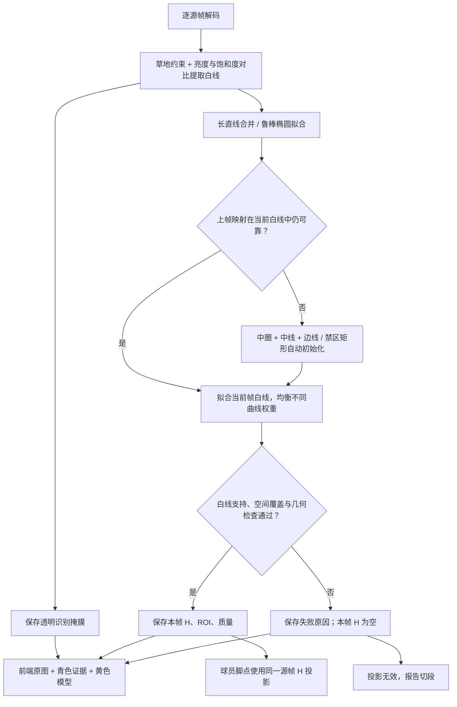
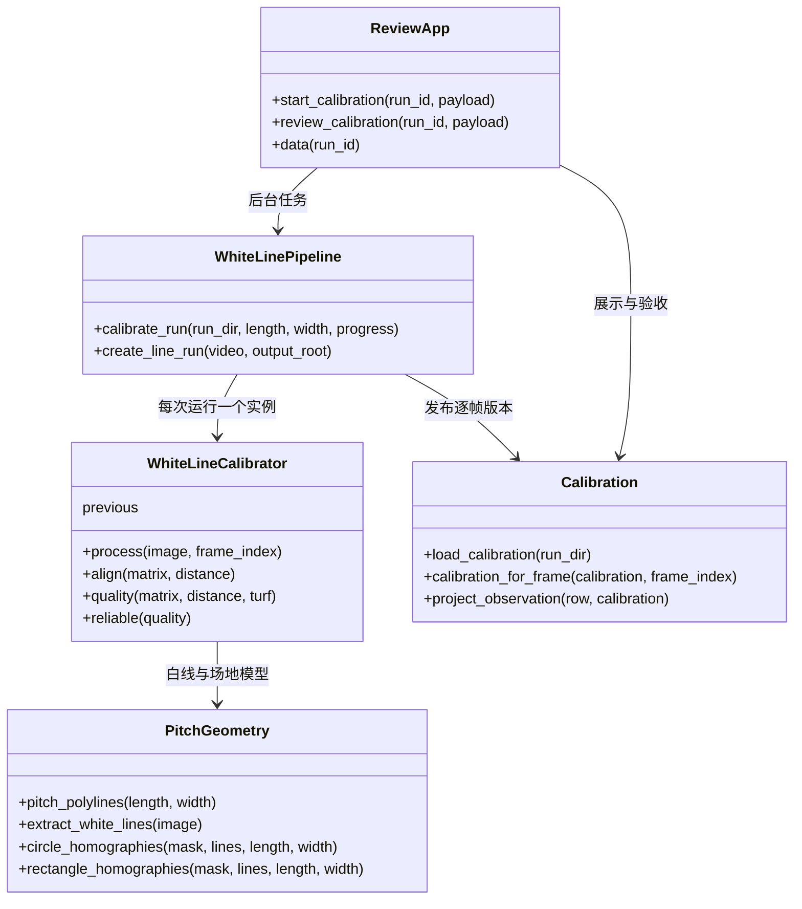

# 13 · 逐帧白线标定与验收

> 日期：2026-10-16。验收目标：相机移动过程中，识别场地白线并持续保持几何对应。首次只填写实际场地尺寸，方向由程序约定。

## 一、当前实现

白线标定独立于人物检测：输入源视频，每个源帧重新提取白线并计算图像到米制球场的 H。上一帧只提供拟合初值；当前帧不满足质量要求时返回无效，不借用旧 H、不插值、不补统计距离。

默认处理宽度 960 px，保存的 H 和 ROI 均恢复到源图像像素坐标。输入尺寸范围为本算法当前支持的长 90–120 m、宽 60–90 m；禁区深 16.5 m、球门区深 5.5 m、中圈半径 9.15 m。长宽须填写实际值，105×68 m 只是默认值。

### 流程图



### 类与接口



`PitchGeometry`、`WhiteLinePipeline`、`Calibration` 是模块接口分组，代码中的状态类是 `WhiteLineCalibrator`、`ReviewApp`。

## 二、自动初始化与失效判断

- 中场视角：从白线中拟合中圈椭圆，结合中线、两侧边线恢复平面映射。
- 禁区视角：枚举两组直线的矩形对应，通过完整球场模型评分排除错误假设。
- 初始图像向右约定为球场 x 正向，远边到近边为 y 正向；这不表示主客队进攻方向。无需用户确认方向，也不自动识别球队进攻方向。
- 当前帧白线支持率至少 65%，空间均衡采样的白色线索覆盖率至少 30%，至少四条模型曲线获得支持，中位线距不超过工作图 3 px。
- 同时拒绝退化矩阵、穿过场地的投影奇点、过小的可见范围和广告区域中的局部巧合。
- 青色是白色候选像素，可能包含白衣、球门网和广告；黄色才是通过几何匹配的场地模型。覆盖率按空间均衡采样，避免球门网的大量像素主导判断。

强光素材中草地与白线的亮度相近，仅用亮度阈值会漏掉禁区远端线，造成中圈正确、画面边缘偏离。当前同时使用局部饱和度差，并对长短曲线均衡加权；有独立回归测试覆盖这一情况。

## 三、前端使用

1. 启动 `python -m footballer_analyzer serve --port 8765`，选择已有运行。
2. 打开“场地标定”，填写实际长宽，点击“运行逐帧白线标定”。任务在后台处理，页面显示进度。
3. 播放相机移动过程，对照实际白线与黄色模型；分别切换“白线证据”“场地模型”便于观察。
4. 动态模式的滑条、上一帧、下一帧和源帧跳转均能检查每个源帧，即使人物跟踪用了 stride 抽帧。“下一失败帧”定位无效几何。
5. 观察首、中、末以及镜头转向、变焦和遮挡时的情况；检查后勾选验收并保存。修改尺寸需重新标定。

标定失败帧隐藏黄色模型和球员投影，明确显示“白线不足”。报告使用相同逐帧 H，失败及缺帧处切段。改变标定版本会令旧报告显示过期。

## 四、CLI 与产物

```powershell
# 已有人物轨迹：只重算标定
& .\.venv\Scripts\python.exe -m footballer_analyzer calibrate-lines --run outputs/run_... --pitch-length 105 --pitch-width 68

# 独立验收：无需人物模型，前端也能选择此运行
& .\.venv\Scripts\python.exe -m footballer_analyzer calibrate-lines --video data/clips/goodview_15s.mp4 --pitch-length 105 --pitch-width 68

# 输出全片叠加视频、失败区间、抽样图和独立参考点误差
& .\.venv\Scripts\python.exe scripts/review_pitch_calibration.py --run outputs/run_... --reference configs/calibration_review_goodview.json
```

独立视频可指定 `--start-frame`、`--end-frame`。已有运行严格使用原分析区间，白线仍逐源帧计算。部分素材容器报告帧数多于实际解码帧数：独立验收默认读到解码结束并记录实际区间及容器原帧数；显式指定的结束帧或已有运行解码失败时，不替换原标定。

```text
outputs/run_*/
  calibration.yaml                    当前标定版本及验收状态
  calibrations/lines_*/
    calibration.yaml                  此版本初始元数据
    frames.json                       每个源帧的 H、ROI、状态与质量
    summary.json                      有效帧数与耗时
    masks/<源帧号>.png                  透明青色白线候选
    review/                           复查脚本的默认输出目录
      white-lines.mp4                 全片模型对拍
      frame_*.jpg / review.json        抽样、失败区间与参考点误差
```

完成后才原子更新 `calibration.yaml`。旧版本及人物检测缓存保留；掩膜接口绑定版本 ID，旧页面不会误读新版本证据。验收状态写入时检查版本，避免确认错误结果。

## 五、实片验收记录

两段素材均为 1920×1080、25 FPS。算法不读取 `configs/calibration_review_*.json`，这些点由原图独立人工粗选，仅在复查脚本中使用。人工点位自身约有数像素误差；抽样误差不等于全片逐像素精度证明。

最终数值见下表及本地 `outputs/pitch-review/*-final/review.json`。

| 素材 | 实际解码帧数 | 逐帧匹配有效 | 标定耗时 | 独立人工参考 |
|---|---:|---:|---:|---|
| goodview_15s | 377 | 377 | 47.6 s | 2 帧 9 点，源图中位误差 3.38 px、最大 5.77 px |
| barca_girona_45m00s | 1503 | 1503 | 193.7 s | 3 帧 13 点，源图中位误差 2.86 px、最大 12.36 px；包含禁区和移动至中场后的中圈 |

本机 CPU 测量含解码、拟合和逐帧 PNG 写盘，测试期间还有并发复查，不作为独占资源的性能基准。两段合计 1880 帧，均无失败区间；另在现有 5 秒人物运行中通过前端启动，125/125 帧匹配有效、耗时 14.4 s，人物追踪缓存未重算。

本次本地运行分别为 `run_20261015T174543_53048939`、`run_20261015T175144_41a1e38e`。完整对拍视频位于 `outputs/pitch-review/goodview-final/white-lines.mp4` 与 `outputs/pitch-review/barca45-final/white-lines.mp4`。

已生成全片对拍视频并检查首、中、末、最差拟合及独立参考帧。有效帧数表示算法自身质量门槛通过，不能单独证明“所有线条在所有帧完全正确”；连续视频可供进一步逐帧复查。当前仍不承诺所有素材、任意近景、严重遮挡、鱼眼畸变或切镜均能恢复标定。

自动化测试覆盖：移动与变焦的独立已知几何、强光白线、白线缺失不沿用旧 H、恢复后重新初始化、广告和单线拒绝、逐帧索引、透明掩膜、报告切段、版本与路径隔离。`unittest discover -s tests -v` 共 30 项通过；`node --check src/footballer_analyzer/web/app.js` 和 `git diff --check` 通过。
